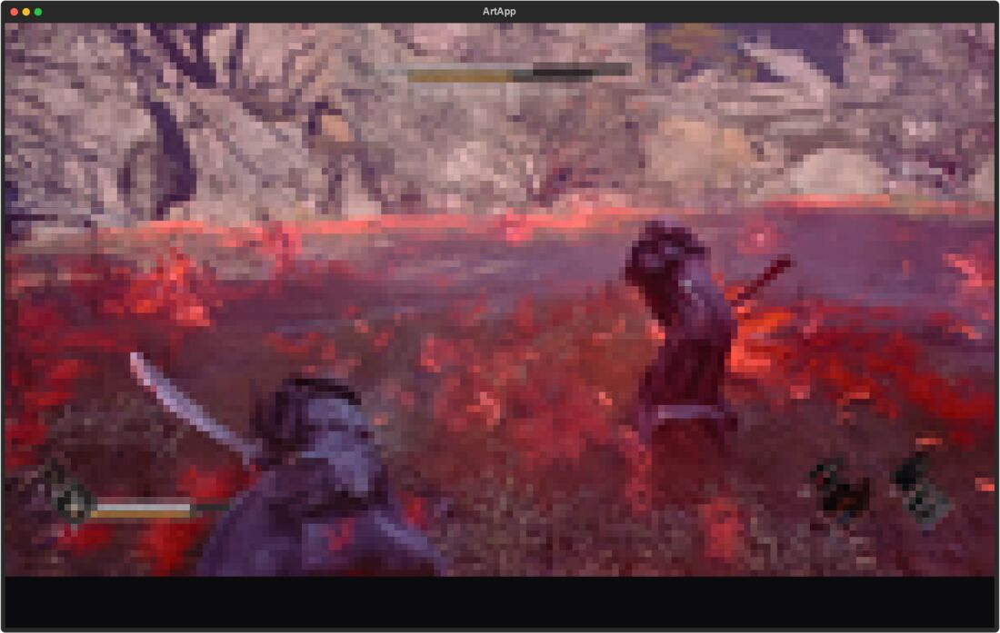

<div align="center">


**Terminal video studio: browse clips as colour art, cut losslessly, tone-map HDR, export for Shorts.**

</div>

---

`tstudio` cuts video **without re-encoding it**, so a clip is bit-for-bit the quality of the
source — a 30-second cut from a 3.7 GB 4K capture takes under a second. It browses folders with
real thumbnails drawn as coloured text, reads HDR10 correctly instead of washing it out to grey,
and exports for YouTube Shorts, Instagram Reels, TikTok and X in a single command.

It was built for NVIDIA ShadowPlay gameplay captures — 4K, 120 fps, HDR10, ~105 Mbps, several
gigabytes for a few minutes — which is the case most tools handle badly.

```bash
tstudio raid.mp4 3:49                      # cut from 3:49 to the end, losslessly
tstudio raid.mp4 3:49-4:19 --for shorts    # a vertical Shorts clip, tone-mapped
tstudio raid.mp4 --to 1080p                # 4K down to 1080p, HDR preserved
tstudio raid.mp4 --tui                     # the interactive editor
```

---

## Pictures, in a terminal



That is a frame of a 4K HDR video, drawn inside a terminal at 150×46 characters. Every cell is a
single `▀` glyph carrying two 24-bit colours — the top pixel as foreground, the bottom as
background — so one row of text holds two rows of pixels.

No sixel, no kitty protocol, no image libraries: ImageMagick decodes to a PPM, a few lines of
Python parse it, and the result is ordinary styled text that any truecolor terminal renders.

## HDR, done properly


A 4K HDR10 capture uses the PQ transfer curve and the bt2020 colour space. Scale it naively and
the PQ curve gets read as ordinary gamma: the result is the grey, desaturated picture on the left.
Most quick conversions do exactly this.

`tstudio` detects HDR from the transfer function and tone-maps with **libplacebo**, falling back to
a **zscale** chain where libplacebo is missing. `--hdr keep` preserves HDR10 instead, and
`--hdr sdr` forces the tone-mapped version.

## Vertical without losing the frame


A 16:9 frame does not fit a 9:16 phone screen, so you choose:

- **`--fit pad`** (default) — the whole frame over a blurred copy of itself. Nothing is lost.
- **`--fit crop`** — fills the screen, at the cost of the left and right thirds, HUD included.

The default never silently discards picture.

## The gallery


`tstudio` browses folders without touching ffmpeg, so a directory of 4 GB captures opens
instantly — sizes and dates come from `stat`, and only the selected file is ever probed. Star a
clip with `f` and it turns up under Favourites however deep it was buried.

## The editor


`tstudio VIDEO --tui` opens an interactive editor over the same engine: set a range, pick cut /
convert / social, see exactly which keyframe the cut will land on and what file it will write,
then run it. `F5` cuts, `F2` toggles the ffmpeg command, `F3` resets, `Ctrl+Q` quits.

---

## Install

Python 3.12 and **ffmpeg** on PATH. Nothing else is required.

```bash
git clone https://github.com/mehulchachada/tstudio.git
cd tstudio
python -m tstudio --help
```

For a `tstudio` command anywhere, put a wrapper on your PATH. On Windows:

```bat
@echo off
set "PYTHONPATH=C:\path\to\tstudio;%PYTHONPATH%"
python -m tstudio %*
```

On Linux or macOS:

```bash
#!/usr/bin/env bash
PYTHONPATH="/path/to/tstudio:$PYTHONPATH" exec python3 -m tstudio "$@"
```

The TUI additionally needs [Textual](https://github.com/Textualize/textual). It is optional — the
command line works without it:

```bash
pip install textual
```

## Usage

### Cutting — lossless by default

```bash
tstudio raid.mp4 3:49                        # 3:49 to the end
tstudio raid.mp4 3:49-4:30                   # a range
tstudio raid.mp4 1:00-1:05 2:00-2:05 9:12    # several clips in one command
tstudio raid.mp4 "last 45s"                  # relative to the file's length
tstudio raid.mp4 "first 20%"
tstudio raid.mp4 "around 3:49 +10s-15s"
```

Times accept `90`, `1:30`, `1:02:03.5`, `2m30s`, `500ms`. Relative forms contain spaces, so quote
them.

A stream copy can only begin on a keyframe, so the start snaps to the nearest one at or before the
time you asked for — and `tstudio` tells you how far it moved rather than hiding it:

```
asked    3:49.000 -> end
cutting  3:48.822 -> 5:00.180   (nearest keyframe, 0.178s earlier)
length   1:11.357   lossless stream copy
```

Use `--exact` when the start must land on an exact frame; that re-encodes, which is the only way.

### Converting

```bash
tstudio raid.mp4 --to 1080p                  # keeps HDR if the source has it
tstudio raid.mp4 --to 1080p --hdr sdr        # tone-map down to SDR
tstudio raid.mp4 3:49-4:19 --to 720p --fps 30
```

Targets: `2160p 1440p 1080p 720p 480p 360p 240p`. Downscale only; the width follows the source's
aspect ratio, so ultrawide stays ultrawide.

### Social export

```bash
tstudio raid.mp4 3:49-4:19 --for shorts --fit crop
tstudio raid.mp4 --for reels
tstudio raid.mp4 --for x
```

| Preset | Size | Warns past |
|---|---|---|
| `shorts` | 1080×1920 | 180 s |
| `reels` | 1080×1920 | 90 s |
| `tiktok` | 1080×1920 | 600 s |
| `x` | 1920×1080 | 140 s |
| `square` | 1080×1080 | 60 s |

Aliases: `youtube-shorts`, `yt-shorts`, `instagram`, `twitter`. Every preset outputs SDR H.264 +
AAC with `+faststart`, capped at 60 fps. Going over a platform's limit prints a warning, not an
error.

Both `--to` and `--for` accept a range and run in **one ffmpeg pass** — no multi-gigabyte
intermediate file.

### Looking without converting

```bash
tstudio raid.mp4 --info              # streams, bitrates, keyframe spacing
tstudio raid.mp4 --keyframes 3:49    # marks the one a lossless cut would use
tstudio raid.mp4 3:49 --dry-run      # print the ffmpeg command, write nothing
```

### Options

| | |
|---|---|
| `-o PATH` | destination (single range only) |
| `-O DIR` | write outputs into DIR |
| `--exact` | re-encode so the cut starts exactly where asked |
| `--encoder` | `auto` · `hevc_nvenc` · `h264_nvenc` · `libx265` · `libx264` |
| `-q N` | crf/cq, lower is better |
| `--mute` | drop audio |
| `--overwrite` | replace instead of writing `_2` |
| `--quiet` | print only the output path |

Nothing is ever overwritten by default — a repeat run writes `_2`.

Exit codes: `0` fine · `2` bad input (one line, no traceback) · `1` unexpected · `130` interrupted.

## How it is built

```
tstudio/
  cli.py          argument parsing, output, exit codes
  tui.py          the Textual editor (imports textual lazily)
  timespec.py     time and range parsing, output naming   — pure, no ffmpeg
  media.py        ffprobe: streams, duration, keyframes, HDR detection
  cut.py          lossless and exact cutting
  convert.py      resolution and colour conversion, tone-mapping
  presets.py      the social platform table
  gallery/        folder listing, favourites, thumbnails, clipboard, trash, branding
```

The package needs only the standard library. Textual is imported inside the TUI's builder, so the
command line never depends on it.

## Tests

```bash
python -m unittest discover -s tests -t tests
```

261 tests. They are not mocks: `tests/fixture.py` generates small real videos with ffmpeg —
including a genuine **HDR10** fixture — and the suite performs actual cuts and conversions against
them, then probes the results. The TUI has a layout test that fails if any widget leaves a
100×34 terminal.

## Licence

MIT — see [LICENSE](LICENSE).
