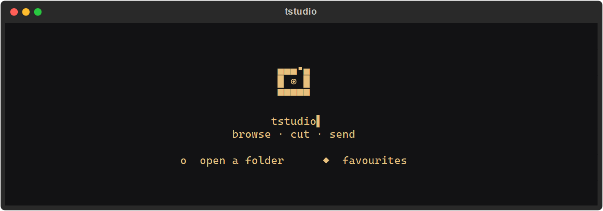
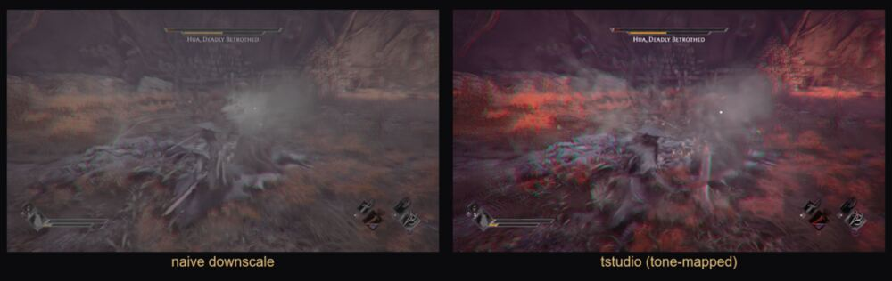
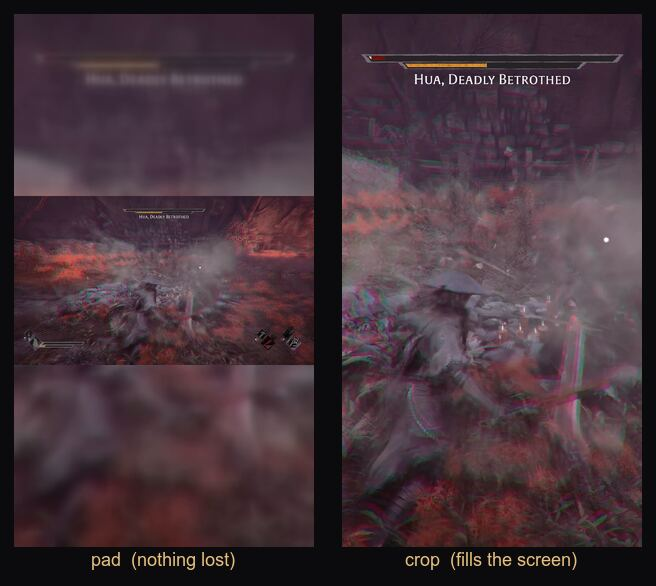
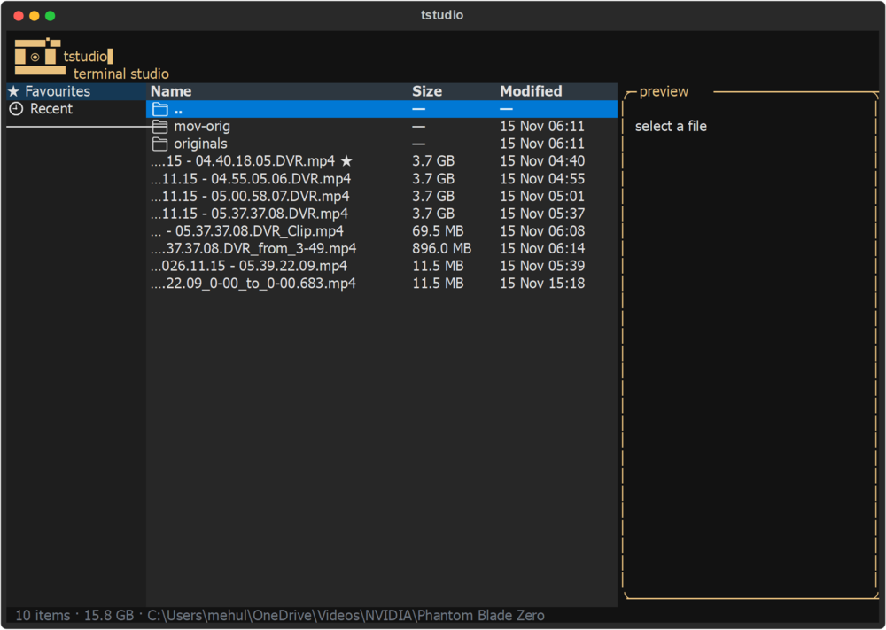
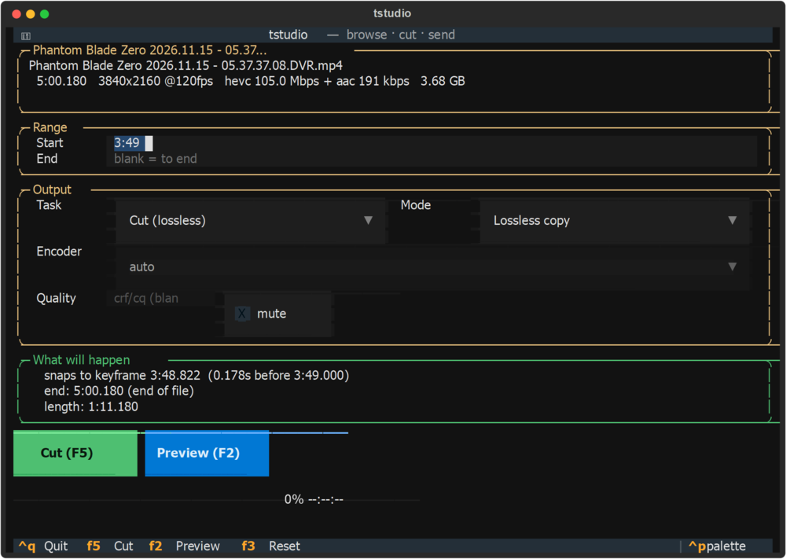

<div align="center">



**A terminal video editor: browse your captures in a gallery, cut them losslessly,
tone-map HDR, export for Shorts.**

</div>

---

`tstudio` cuts video **without re-encoding it**, so a clip is bit-for-bit the quality of the
source — a 30-second cut from a 3.7 GB 4K capture takes under a second. It browses folders in a
gallery, opens any clip in a full editor, reads HDR10 correctly instead of washing it out to grey,
and exports for YouTube Shorts, Instagram Reels, TikTok and X in a single command.

It was built for NVIDIA ShadowPlay gameplay captures — 4K, 120 fps, HDR10, ~105 Mbps, several
gigabytes for a few minutes — which is the case most tools handle badly.

```bash
tstudio                                    # browse the current folder
tstudio raid.mp4 3:49                      # cut from 3:49 to the end, losslessly
tstudio raid.mp4 3:49-4:19 --for shorts    # a vertical Shorts clip, tone-mapped
tstudio raid.mp4 --to 1080p                # 4K down to 1080p, HDR preserved
tstudio raid.mp4 --tui                     # the interactive editor
```

---

## HDR, done properly



A 4K HDR10 capture uses the PQ transfer curve and the bt2020 colour space. Scale it naively and
the PQ curve gets read as ordinary gamma: the result is the grey, desaturated picture on the left.
Most quick conversions do exactly this.

`tstudio` detects HDR from the transfer function and tone-maps with **libplacebo**, falling back to
a **zscale** chain where libplacebo is missing. `--hdr keep` preserves HDR10 instead, and
`--hdr sdr` forces the tone-mapped version.

## Vertical without losing the frame



A 16:9 frame does not fit a 9:16 phone screen, so you choose:

- **`--fit pad`** (default) — the whole frame over a blurred copy of itself. Nothing is lost.
- **`--fit crop`** — fills the screen, at the cost of the left and right thirds, HUD included.

The default never silently discards picture.

## The gallery



`tstudio` with no arguments browses the current folder, and it never touches ffmpeg to do it: a
directory of 4 GB captures opens instantly, because sizes and dates come from `stat` and only the
file under the cursor is ever probed.

The preview tells you what a file **is** rather than trying to be it — the kind, then length,
resolution, frame rate, codec, colour and size. It deliberately does not draw the frame. That
needs sixel, which most terminals do not have, and pulling a frame out of a 3.7 GB 4K source
takes seconds, so the pane sat blank while you scrolled past it. `p` hands the file to **mpv**
instead, where it is a real picture at full resolution.

`f` marks a favourite, which then turns up under Favourites however deep it was buried. `bksp`
goes up a folder, `/` filters the listing, `Enter` on a video opens it in the editor.

## The editor



`tstudio VIDEO --tui` opens the editor over the same engine; `Enter` on a clip in the gallery
does the same thing.

Seven controls, in the order you think about them: **CLIP** (one range, `3:49-4:19`), **PRESET**,
**SIZE**, **SHAPE**, **COLOUR**, **FPS** and **AUDIO**. Choosing a preset fills in the rest.
Changing one afterwards is allowed — the editor notes which preset you have drifted from instead
of quietly overriding you, and it only offers what the source can actually do, so an SDR file is
never asked about HDR.

Underneath, it says what will happen before anything runs: which keyframe the cut will snap to
and by how much, what the output will be called, how long it will be, and whether the result is a
lossless copy or a re-encode.

`F5` exports · `F2` plays the clip · `F6` plays the result · `F7` shows the ffmpeg command ·
`F4` copies it · `F3` resets · `Esc` goes back.

---

## Install

Python 3.12 and **ffmpeg** on PATH. Nothing else is required.

```bash
git clone https://github.com/mehulchachada/tstudio.git
cd tstudio
python -m tstudio --help
```

For a `tstudio` command anywhere, put a wrapper on your PATH. On Windows:

```bat
@echo off
set "PYTHONPATH=C:\path\to\tstudio;%PYTHONPATH%"
python -m tstudio %*
```

On Linux or macOS:

```bash
#!/usr/bin/env bash
PYTHONPATH="/path/to/tstudio:$PYTHONPATH" exec python3 -m tstudio "$@"
```

The gallery and the editor additionally need [Textual](https://github.com/Textualize/textual).
It is optional — the command line works without it:

```bash
pip install textual
```

Playing a clip (`p` in the gallery, `F2` and `F6` in the editor) hands it to
[mpv](https://mpv.io) if mpv is on PATH. Everything else works without it.

## Usage

### Cutting — lossless by default

```bash
tstudio raid.mp4 3:49                        # 3:49 to the end
tstudio raid.mp4 3:49-4:30                   # a range
tstudio raid.mp4 1:00-1:05 2:00-2:05 9:12    # several clips in one command
tstudio raid.mp4 "last 45s"                  # relative to the file's length
tstudio raid.mp4 "first 20%"
tstudio raid.mp4 "around 3:49 +10s-15s"
```

Times accept `90`, `1:30`, `1:02:03.5`, `2m30s`, `500ms`. Relative forms contain spaces, so quote
them.

A stream copy can only begin on a keyframe, so the start snaps to the nearest one at or before the
time you asked for — and `tstudio` tells you how far it moved rather than hiding it:

```
asked    3:49.000 -> end
cutting  3:48.822 -> 5:00.180   (nearest keyframe, 0.178s earlier)
length   1:11.357   lossless stream copy
```

Use `--exact` when the start must land on an exact frame; that re-encodes, which is the only way.

### Converting

```bash
tstudio raid.mp4 --to 1080p                  # keeps HDR if the source has it
tstudio raid.mp4 --to 1080p --hdr sdr        # tone-map down to SDR
tstudio raid.mp4 3:49-4:19 --to 720p --fps 30
```

Targets: `2160p 1440p 1080p 720p 480p 360p 240p`. Downscale only; the width follows the source's
aspect ratio, so ultrawide stays ultrawide.

### Social export

```bash
tstudio raid.mp4 3:49-4:19 --for shorts --fit crop
tstudio raid.mp4 --for reels
tstudio raid.mp4 --for x
```

| Preset | Size | Warns past |
|---|---|---|
| `shorts` | 1080×1920 | 180 s |
| `reels` | 1080×1920 | 90 s |
| `tiktok` | 1080×1920 | 600 s |
| `x` | 1920×1080 | 140 s |
| `square` | 1080×1080 | 60 s |

Aliases: `youtube-shorts`, `yt-shorts`, `instagram`, `twitter`. By default every preset outputs
SDR H.264 + AAC with `+faststart`, capped at 60 fps. Going over a platform's limit prints a
warning, not an error.

A preset can keep HDR10 instead:

```bash
tstudio raid.mp4 3:49-4:19 --for shorts --hdr keep
```

The 9:16 reframing is unchanged — only the tone-map and the 8-bit flatten are skipped — and an
HEVC or AV1 encoder is picked automatically, because h264 cannot carry HDR in either flavour.
In the editor the same thing is COLOUR set back to `HDR10` after choosing a preset — that control
offers the two colours an output can be, `HDR10` and `SDR`.

Note the deliberate asymmetry: `--hdr auto` **keeps** HDR under `--to` and **tone-maps** under
`--for`. Converting a capture you are keeping should not throw colour away, but a social export
goes to a platform that expects SDR, so there HDR is something you ask for. `--hdr keep` on an
SDR source is an error either way — HDR cannot be invented.

Both `--to` and `--for` accept a range and run in **one ffmpeg pass** — no multi-gigabyte
intermediate file.

### Looking without converting

```bash
tstudio raid.mp4 --info              # streams, bitrates, keyframe spacing
tstudio raid.mp4 --keyframes 3:49    # marks the one a lossless cut would use
tstudio raid.mp4 3:49 --dry-run      # print the ffmpeg command, write nothing
```

### Options

| | |
|---|---|
| `-o PATH` | destination (single range only) |
| `-O DIR` | write outputs into DIR |
| `--exact` | re-encode so the cut starts exactly where asked |
| `--encoder` | `auto` · `hevc_nvenc` · `h264_nvenc` · `libx265` · `libx264` |
| `-q N` | crf/cq, lower is better |
| `--mute` | drop audio |
| `--overwrite` | replace instead of writing `_2` |
| `--quiet` | print only the output path |

Nothing is ever overwritten by default — a repeat run writes `_2`.

Exit codes: `0` fine · `2` bad input (one line, no traceback) · `1` unexpected · `130` interrupted.

## How it is built

```
tstudio/
  cli.py          argument parsing, output, exit codes
  tui.py          the Textual editor (imports textual lazily)
  recipe.py       what the editor's seven controls mean, and the plan they produce
  theme.py        the one colour theme the gallery and the editor share
  timespec.py     time and range parsing, output naming   — pure, no ffmpeg
  media.py        ffprobe: streams, duration, keyframes, HDR detection
  cut.py          lossless and exact cutting
  convert.py      resolution and colour conversion, tone-mapping
  presets.py      the social platform table
  gallery_app.py  the browser
  gallery/        listing, favourites, preview art, playback, clipboard, trash, branding
```

The package needs only the standard library. Textual is imported inside the TUI's builder, so the
command line never depends on it.

## Tests

```bash
python -m unittest discover -s tests -t tests
```

576 tests. They are not mocks: `tests/fixture.py` generates small real videos with ffmpeg —
including a genuine **HDR10** fixture — and the suite performs actual cuts and conversions against
them, then probes the results. The gallery and the editor are driven through Textual's own test
pilot, and the editor has a layout test that fails if any widget leaves a 100×34 terminal.

## Licence

MIT — see [LICENSE](LICENSE).
